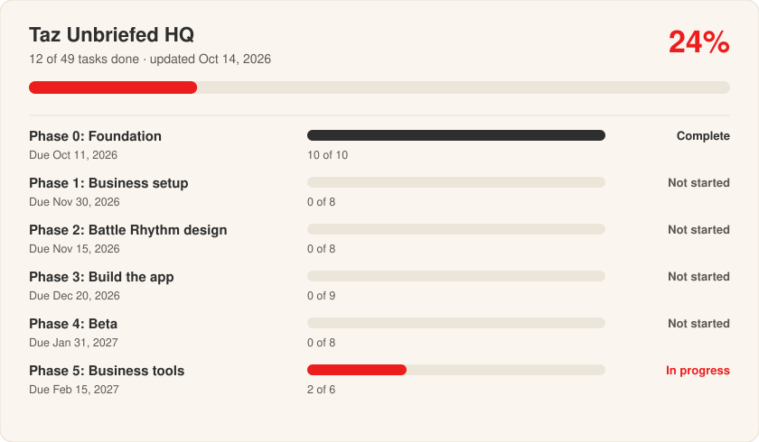

# Taz Unbriefed HQ

How Taz Unbriefed runs its work: building **Battle Rhythm**, a daily structure app for veterans with ADHD, and the **Taz Unbriefed** content brand that tells the story. *The stuff they don't brief you on.*

**Project board:** https://taz-unbriefed.github.io/hq-/

<!-- STATUS:START -->

| Phase | Due | Done | Status |
| --- | --- | --- | --- |
| Phase 0: Foundation | Oct 11, 2026 | 10 / 10 | Complete |
| Phase 1: Business setup | Nov 30, 2026 | 0 / 8 | Not started |
| Phase 2: Battle Rhythm design | Nov 15, 2026 | 0 / 8 | Not started |
| Phase 3: Build the app | Dec 20, 2026 | 0 / 9 | Not started |
| Phase 4: Beta | Jan 31, 2027 | 0 / 8 | Not started |
| Phase 5: Business tools | Feb 15, 2027 | 2 / 6 | In progress |

**Up next (Phase 2: Battle Rhythm design):**

- [ ] [#19 Map the B.U.M.P. daily flow](https://github.com/Taz-Unbriefed/hq-/issues/19)
- [ ] [#20 Wireframe the five tabs](https://github.com/Taz-Unbriefed/hq-/issues/20)
- [ ] [#21 Design the first-week setup](https://github.com/Taz-Unbriefed/hq-/issues/21)
- [ ] [#22 Spec the crisis button](https://github.com/Taz-Unbriefed/hq-/issues/22)
- [ ] [#23 Design the daily check-in](https://github.com/Taz-Unbriefed/hq-/issues/23)

**Decisions waiting on you:**

- [#15 Set the first-year budget](https://github.com/Taz-Unbriefed/hq-/issues/15)
- [#16 Check the Battle Rhythm name for trademark conflicts](https://github.com/Taz-Unbriefed/hq-/issues/16)
- [#18 Pick a bookkeeping tool](https://github.com/Taz-Unbriefed/hq-/issues/18)
- [#26 Decide what data the app stores](https://github.com/Taz-Unbriefed/hq-/issues/26)
- [#27 Choose the cross-platform app stack](https://github.com/Taz-Unbriefed/hq-/issues/27)

_Updated automatically Oct 25, 2026._
<!-- STATUS:END -->

## How this works

- **Every task is an Issue** with an owner, a due date, and the tasks it waits on. **Every phase is a Milestone.**
- **The project board** (link above) shows progress, the calendar, messages, the team, documents, and a progress report. Visitors can look; changes need the owner's key.
- **Labels:** `business`, `design`, `build`, `testing`, `content`, and `decision` (needs a choice before work can move).
- Each issue ends with hidden notes the board reads (`<!-- keystone:due=… -->`, `owner`, `after`). Leave them in place when editing on GitHub.

## First-time setup

1. **Settings → Actions → General → Workflow permissions → Read and write → Save.**
2. **Settings → Pages → Deploy from a branch → main, /docs → Save.**
3. **Actions → Load tasks → Run workflow.** The tasks, phases, labels, and board data appear in about two minutes.
4. Make an owner key (fine-grained token for this repository with **Issues** and **Contents: Read and write**) and sign in from the board's footer.

## What's in this repo

| Path | What it is |
| --- | --- |
| `tracker/tasks.json` | The plan: phases, tasks, labels, owners, due dates, and task links |
| `tracker/team.json` | The team: name, title, and department |
| `tracker/calendar.json` | Check-ins, batch sessions, reviews, and closures |
| `tracker/documents.json` | Program documents (added from the board) |
| `tracker/messages.json` | Messages sent when a task is done and the next task belongs to someone else |
| `scripts/` | Loads the plan into GitHub and rebuilds the board's data |
| `.github/workflows/` | The two automations: Load tasks, Update dashboard |
| `docs/` | The project board website |

Built from the Project Keystone Tracker v1.0 master.
